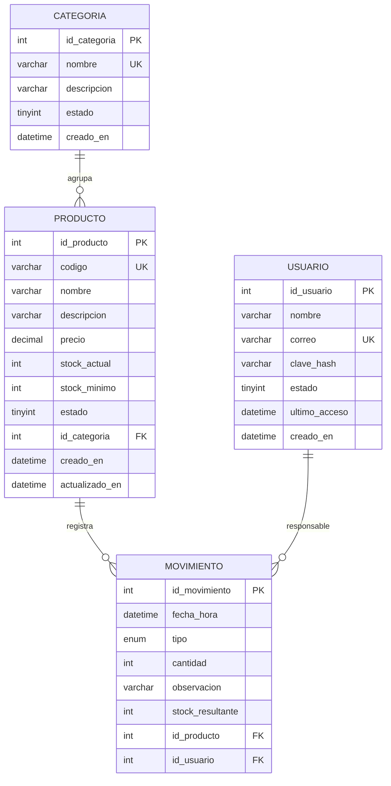

# Modelo e implementación de la base de datos

**Motor:** MySQL 8 / MariaDB 10.4 o superior  
**Base de datos:** `tecnostock`  
**Script:** `database/tecnostock.sql`  
**Codificación:** `utf8mb4` · **Colación:** `utf8mb4_unicode_ci`  
**Motor de tablas:** InnoDB

## 1. Objetivo del modelo

El modelo debe sostener el flujo completo del inventario: un usuario registra productos agrupados en categorías, y cada entrada o salida queda asociada a un producto y a un usuario responsable. El diseño prioriza la integridad: evita códigos duplicados, valores negativos, movimientos huérfanos y actualizaciones de stock sin respaldo.

## 2. Diagrama entidad-relación



### 2.1 Esquema relacional

```text
categoria(id_categoria PK, nombre UQ, descripcion, estado, creado_en)

usuario(id_usuario PK, nombre, correo UQ, clave_hash, estado, ultimo_acceso, creado_en)

producto(id_producto PK, codigo UQ, nombre, descripcion, precio,
         stock_actual, stock_minimo, estado, id_categoria FK,
         creado_en, actualizado_en)

movimiento(id_movimiento PK, fecha_hora, tipo, cantidad, observacion,
           stock_resultante, id_producto FK, id_usuario FK)
```

### 2.2 Cardinalidades

| Relación | Cardinalidad | Regla |
|---|---|---|
| Categoría → Producto | 1 : N | Una categoría agrupa muchos productos; un producto pertenece a una sola categoría. |
| Producto → Movimiento | 1 : N | Un producto acumula muchos movimientos; cada movimiento afecta a un solo producto. |
| Usuario → Movimiento | 1 : N | Un usuario registra muchos movimientos; cada movimiento tiene un responsable. |

## 3. Diccionario de datos

### 3.1 Tabla `categoria`

| Columna | Tipo | Nulo | Restricción | Descripción |
|---|---|---|---|---|
| `id_categoria` | INT UNSIGNED | No | PK, AUTO_INCREMENT | Identificador interno. |
| `nombre` | VARCHAR(60) | No | UNIQUE | Nombre visible de la categoría. |
| `descripcion` | VARCHAR(180) | Sí | — | Detalle opcional. |
| `estado` | TINYINT(1) | No | DEFAULT 1, CHECK (0,1) | 1 = activa, 0 = desactivada. |
| `creado_en` | DATETIME | No | DEFAULT CURRENT_TIMESTAMP | Fecha de creación. |

### 3.2 Tabla `usuario`

| Columna | Tipo | Nulo | Restricción | Descripción |
|---|---|---|---|---|
| `id_usuario` | INT UNSIGNED | No | PK, AUTO_INCREMENT | Identificador interno. |
| `nombre` | VARCHAR(80) | No | — | Nombre del encargado. |
| `correo` | VARCHAR(120) | No | UNIQUE | Credencial de acceso. |
| `clave_hash` | VARCHAR(255) | No | — | Hash bcrypt generado con `password_hash`. |
| `estado` | TINYINT(1) | No | DEFAULT 1, CHECK (0,1) | 1 = activo, 0 = inactivo. |
| `ultimo_acceso` | DATETIME | Sí | — | Última autenticación exitosa. |
| `creado_en` | DATETIME | No | DEFAULT CURRENT_TIMESTAMP | Fecha de creación. |

### 3.3 Tabla `producto`

| Columna | Tipo | Nulo | Restricción | Descripción |
|---|---|---|---|---|
| `id_producto` | INT UNSIGNED | No | PK, AUTO_INCREMENT | Identificador interno. |
| `codigo` | VARCHAR(20) | No | UNIQUE | Código comercial único (ej. `TEC-001`). |
| `nombre` | VARCHAR(100) | No | — | Nombre del producto. |
| `descripcion` | VARCHAR(255) | Sí | — | Características o compatibilidad. |
| `precio` | DECIMAL(10,2) | No | CHECK (>= 0) | Precio unitario en CLP. |
| `stock_actual` | INT | No | DEFAULT 0, CHECK (>= 0) | Existencias disponibles. |
| `stock_minimo` | INT | No | DEFAULT 0, CHECK (>= 0) | Punto de reposición. |
| `estado` | TINYINT(1) | No | DEFAULT 1, CHECK (0,1) | 1 = activo, 0 = desactivado. |
| `id_categoria` | INT UNSIGNED | No | FK → `categoria` | Categoría del producto. |
| `creado_en` | DATETIME | No | DEFAULT CURRENT_TIMESTAMP | Fecha de creación. |
| `actualizado_en` | DATETIME | No | ON UPDATE CURRENT_TIMESTAMP | Última modificación. |

### 3.4 Tabla `movimiento`

| Columna | Tipo | Nulo | Restricción | Descripción |
|---|---|---|---|---|
| `id_movimiento` | INT UNSIGNED | No | PK, AUTO_INCREMENT | Identificador interno. |
| `fecha_hora` | DATETIME | No | DEFAULT CURRENT_TIMESTAMP | Fecha y hora del movimiento. |
| `tipo` | ENUM('entrada','salida') | No | — | Naturaleza del movimiento. |
| `cantidad` | INT UNSIGNED | No | CHECK (> 0) | Unidades movidas. |
| `observacion` | VARCHAR(200) | Sí | — | Motivo o referencia. |
| `stock_resultante` | INT | No | CHECK (>= 0) | Stock después de aplicar el movimiento. |
| `id_producto` | INT UNSIGNED | No | FK → `producto` | Producto afectado. |
| `id_usuario` | INT UNSIGNED | No | FK → `usuario` | Responsable del registro. |

## 4. Normalización

### 4.1 Primera forma normal (1FN)

Todos los atributos son atómicos. No existen listas ni grupos repetidos: cada movimiento ocupa una fila independiente y cada producto tiene una sola categoría. Los datos de contacto y las observaciones se almacenan en columnas simples.

### 4.2 Segunda forma normal (2FN)

Las claves primarias son simples (`id_*`), por lo que no existen dependencias parciales. En `movimiento`, todos los atributos describen el movimiento completo y dependen de `id_movimiento`. El producto y el usuario se referencian mediante claves foráneas, no se duplican sus nombres.

### 4.3 Tercera forma normal (3FN)

No hay dependencias transitivas:

- El nombre y la descripción de la categoría viven solo en `categoria`.
- El nombre y el correo del usuario viven solo en `usuario`.
- El producto no repite datos de la categoría; solo guarda `id_categoria`.
- El movimiento no repite nombre del producto ni del usuario; guarda sus claves.

### 4.4 Redundancia controlada

`producto.stock_actual` es teóricamente derivable de la suma de movimientos. Se almacena por rendimiento y por control de concurrencia, pero **solo** se modifica dentro de la transacción que registra un movimiento válido. No existe ningún formulario que permita escribir el stock directamente.

`movimiento.stock_resultante` es una fotografía histórica del stock después del movimiento. Se conserva porque permite auditar el kardex sin recalcular toda la secuencia y porque, si se corrigiera un movimiento antiguo, los valores posteriores seguirían reflejando lo que ocurrió en su momento.

Ambos campos se someten a verificaciones automáticas: la suma de movimientos debe coincidir con el stock actual y el último `stock_resultante` debe coincidir con `stock_actual`.

## 5. Integridad

### 5.1 Integridad de entidad

Cada tabla tiene una clave primaria `INT UNSIGNED AUTO_INCREMENT`. No se permiten filas sin identificador ni duplicados.

### 5.2 Integridad referencial

| Clave foránea | Tabla origen | Tabla destino | ON UPDATE | ON DELETE |
|---|---|---|---|---|
| `fk_producto_categoria` | `producto` | `categoria` | CASCADE | RESTRICT |
| `fk_movimiento_producto` | `movimiento` | `producto` | CASCADE | RESTRICT |
| `fk_movimiento_usuario` | `movimiento` | `usuario` | CASCADE | RESTRICT |

`RESTRICT` impide borrar una categoría con productos o un producto con movimientos. La aplicación, además, no ofrece borrado físico.

### 5.3 Integridad de dominio

- `CHECK (precio >= 0)`.
- `CHECK (stock_actual >= 0)`.
- `CHECK (stock_minimo >= 0)`.
- `CHECK (cantidad > 0)`.
- `CHECK (stock_resultante >= 0)`.
- `CHECK (estado IN (0,1))` en categoría, usuario y producto.
- `ENUM('entrada','salida')` para el tipo de movimiento.
- `UNIQUE` en `producto.codigo`, `categoria.nombre` y `usuario.correo`.

Las restricciones `CHECK` se complementan con validaciones en PHP para entregar mensajes comprensibles. La base de datos actúa como última barrera.

### 5.4 Integridad transaccional del stock

El registro de un movimiento ejecuta esta secuencia:

1. `beginTransaction()`.
2. `SELECT ... FOR UPDATE` sobre el producto para bloquear la fila.
3. Verificación de existencia, estado activo y stock suficiente.
4. `UPDATE producto SET stock_actual = ... WHERE id_producto = ... AND stock_actual = ...`.
5. Verificación de `rowCount() === 1` para detectar cambios concurrentes.
6. `INSERT INTO movimiento (...)` con el stock resultante.
7. `commit()`.

Si cualquier paso falla, se ejecuta `rollBack()`. El `UPDATE` condicionado al stock anterior impide aplicar dos veces el mismo cálculo si otra sesión modificó la fila entre la lectura y la escritura.

### 5.5 Consultas de verificación

**Productos cuyo stock no coincide con la suma de sus movimientos:**

```sql
SELECT p.codigo, p.stock_actual,
       COALESCE(SUM(CASE WHEN m.tipo = 'entrada' THEN m.cantidad ELSE -m.cantidad END), 0) AS calculado
FROM producto p
LEFT JOIN movimiento m ON m.id_producto = p.id_producto
GROUP BY p.id_producto, p.codigo, p.stock_actual
HAVING p.stock_actual <> calculado;
```

Resultado esperado: 0 filas.

**Último stock resultante distinto del stock actual:**

```sql
SELECT p.codigo, p.stock_actual, m.stock_resultante
FROM producto p
INNER JOIN movimiento m ON m.id_movimiento = (
    SELECT MAX(m2.id_movimiento)
    FROM movimiento m2
    WHERE m2.id_producto = p.id_producto
)
WHERE m.stock_resultante <> p.stock_actual;
```

Resultado esperado: 0 filas.

**Productos bajo el stock mínimo:**

```sql
SELECT codigo, nombre, stock_actual, stock_minimo
FROM producto
WHERE estado = 1 AND stock_actual < stock_minimo
ORDER BY (stock_actual = 0) DESC, (stock_minimo - stock_actual) DESC;
```

**Valor del inventario activo:**

```sql
SELECT SUM(stock_actual * precio) AS valorizado
FROM producto
WHERE estado = 1;
```

## 6. Índices

| Índice | Tabla | Uso |
|---|---|---|
| `PRIMARY` | Todas | Búsqueda por identificador y unión de claves foráneas. |
| `uq_producto_codigo` | `producto` | Unicidad y búsqueda exacta por código. |
| `uq_categoria_nombre` | `categoria` | Unicidad de nombres. |
| `uq_usuario_correo` | `usuario` | Login y unicidad de correo. |
| `idx_producto_categoria` | `producto` | Filtros y agrupaciones por categoría. |
| `idx_producto_estado` | `producto` | Filtros de activos/inactivos. |
| `idx_movimiento_producto` | `movimiento` | Kardex por producto. |
| `idx_movimiento_fecha` | `movimiento` | Orden cronológico y filtros por rango. |
| `idx_movimiento_tipo` | `movimiento` | Filtros de entradas/salidas. |

Los listados usan `LIMIT` y `OFFSET` para no cargar todo el catálogo en cada consulta.

## 7. Datos de prueba

El script incluye un conjunto coherente con el flujo:

| Entidad | Registros | Detalle |
|---|---|---|
| Categorías | 7 | 6 activas y 1 desactivada sin productos. |
| Usuarios | 3 | 2 activos y 1 inactivo para probar el rechazo de acceso. |
| Productos | 15 | 13 activos y 2 desactivados. |
| Movimientos | 30 | Entradas y salidas fechadas entre septiembre y noviembre de 2026. |

Los productos incluyen casos límite:

- `TEC-002`, `TEC-004` y `TEC-008`: stock bajo.
- `TEC-006`: stock cero.
- `TEC-013`: stock igual al mínimo (no debe alertar).
- `TEC-014` y `TEC-015`: desactivados con historial.
- `TEC-010`: producto de alto valor para el cálculo de inventario valorizado.

Cada producto tiene una secuencia de movimientos cuyo último `stock_resultante` coincide con su `stock_actual`.

## 8. Instalación y respaldo

### 8.1 Importación desde phpMyAdmin

1. Abrir `http://localhost/phpmyadmin`.
2. Seleccionar la pestaña **Importar**.
3. Elegir `database/tecnostock.sql`.
4. Ejecutar. El script elimina una versión anterior de `tecnostock`, crea la base, las tablas, las restricciones y los datos.

> El script comienza con `DROP DATABASE IF EXISTS tecnostock`. Es intencionalmente reproducible: deja la base en un estado conocido. No debe ejecutarse sobre una base con información real.

### 8.2 Importación por consola

```bash
mysql -u root -p < database/tecnostock.sql
```

### 8.3 Respaldo

```bash
mysqldump -u root -p --databases tecnostock --routines --triggers > respaldo_tecnostock.sql
```

### 8.4 Restauración

```bash
mysql -u root -p < respaldo_tecnostock.sql
```

## 9. Decisiones de modelado

| Decisión | Justificación |
|---|---|
| Claves primarias sustitutas `id_*` | Evitan dependencias del código comercial y facilitan las claves foráneas. |
| `codigo` con `UNIQUE` | Cumple la regla de negocio y permite búsquedas rápidas. |
| `DECIMAL(10,2)` para precio | Evita errores de redondeo de punto flotante. |
| `INT` para cantidades | El inventario se maneja en unidades enteras. |
| `ENUM` para tipo | Restringe el dominio a entrada o salida. |
| InnoDB | Transacciones, bloqueo de filas y claves foráneas. |
| `utf8mb4` | Soporta tildes, símbolos y emoji en nombres y observaciones. |
| `ON DELETE RESTRICT` | Protege el historial; nunca se borra un producto con movimientos. |
| `stock_resultante` | Auditoría del kardex y verificación de consistencia. |
| Sin triggers | La lógica de stock vive en la transacción de PHP, donde se valida el contexto, el usuario y el mensaje de error. Un trigger duplicaría la actualización y dificultaría el diagnóstico. |

## 10. Correspondencia con el caso

| Entidad sugerida por el caso | Implementación | Atributos adicionales justificados |
|---|---|---|
| Usuario | `usuario` | `ultimo_acceso` para auditoría de acceso. |
| Categoría | `categoria` | `creado_en` para orden y trazabilidad. |
| Producto | `producto` | `creado_en` y `actualizado_en` para control de cambios. |
| Movimiento | `movimiento` | `stock_resultante` para auditoría del kardex. |

El modelo mantiene todas las entidades y relaciones solicitadas, agrega marcas de tiempo y un dato de auditoría, y no incorpora entidades fuera del alcance.
